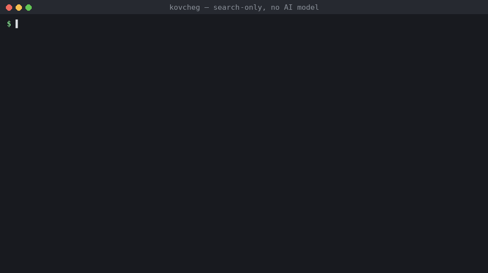
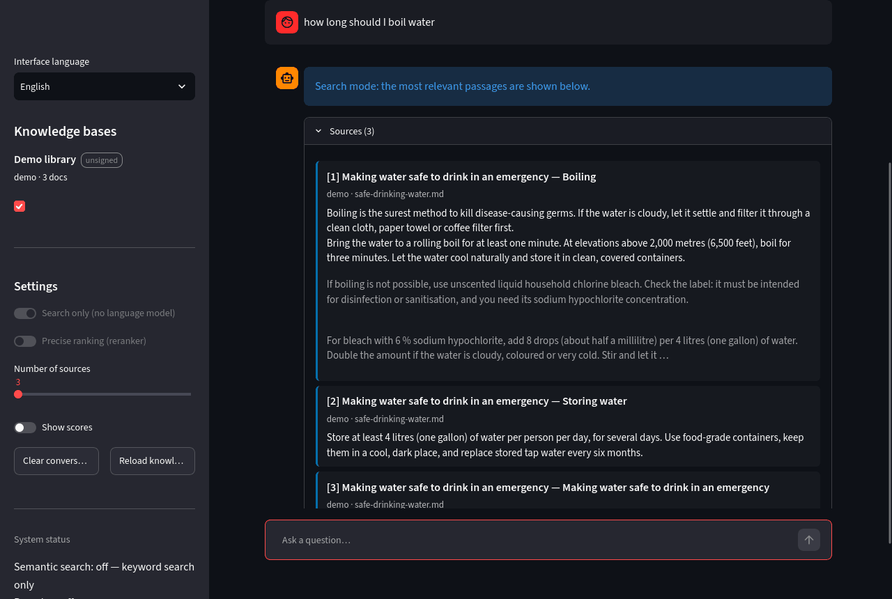

<div align="center">

# Kovcheg (Ковчег) — offline answers from your own documents

**A retrieval-augmented question-answering system that runs with no internet, on a mini PC or from a USB stick, built for emergencies.**

**[▶ Live demo in your browser](https://huggingface.co/spaces/alexshynkarenk0/kovcheg-demo)** · [Українська](README.uk.md) · [Documentation](docs/en/README.md) · [Responsible use](RESPONSIBLE_USE.md) · [Security](SECURITY.md)

`MIT` · `v1.0.0` · `Python ≥ 3.11` · `100 % offline` · `search works with numpy alone`

</div>

---

<p align="center"></p>

<p align="center"><em>Real output on the <a href="examples/DEMO.md">demo library</a>, keyword search only, no AI model installed: the passage that answers the question with its source, and an honest refusal when the library has nothing relevant. Recorded with <code>scripts/make_cli_gif.py</code>.</em></p>

When the network is down — after a disaster, in the field, on a ship, in a shelter, in a basement during an air raid — the knowledge you need is often already on a disk: first-aid manuals, field medicine protocols, equipment documentation, water and power guides, an offline Wikipedia. **Kovcheg** ("ark") turns such a library into something you can ask questions in plain language. It finds the relevant passages and shows them with exact references (document, page, section). If a local language model is available, it also writes a short answer that cites those passages as `[1]`, `[2]`.

Everything runs locally. Nothing is sent anywhere. No account, no telemetry, no cloud.

> [!IMPORTANT]
> Kovcheg finds and summarises what is in **your** documents. It can miss things and a language model can misread them. In a life-threatening situation, follow official protocols and contact emergency services if you can. Always check the cited source before acting. See [RESPONSIBLE_USE.md](RESPONSIBLE_USE.md).

## Contents

- [Why Kovcheg](#why-kovcheg)
- [How it works](#how-it-works)
- [Quick start](#quick-start)
- [Choose your hardware tier](#choose-your-hardware-tier)
- [Building a library](#building-a-library)
- [Asking questions](#asking-questions)
- [Integrity and signed modules](#integrity-and-signed-modules)
- [Running from a USB stick](#running-from-a-usb-stick)
- [Limitations](#limitations)
- [Project layout](#project-layout)
- [License](#license) · [Citation](#citation)

## Why Kovcheg

- **Works at every level of hardware.** With nothing but Python and numpy, Kovcheg is a fast full-text search engine (SQLite FTS5 / BM25) over your library. Add the BGE-M3 embedding model for semantic search across languages, a cross-encoder for more precise ranking, and a small GGUF language model for written answers. Each component is optional and is used only when present.
- **Answers you can check.** Every answer is built only from the numbered sources shown next to it. Citation numbers always match the list. Each source shows its document, page and section. When the library has nothing relevant, Kovcheg says so instead of letting the model guess.
- **Small-computer friendly.** Vectors are stored in float16 and memory-mapped, so a large library does not have to fit in RAM. Models load lazily. The default settings target an 8 GB mini PC without a GPU.
- **Hybrid retrieval.** Dense semantic vectors, BGE-M3 sparse lexical weights and BM25 are fused with weighted Reciprocal Rank Fusion. Exact strings such as `J18.9`, `500 mg` or part numbers are found even when the semantic model does not understand them.
- **Integrity you can verify.** Every knowledge module has a manifest with SHA-256 hashes of its files, optionally signed with Ed25519. Kovcheg shows whether a module is intact, unsigned or modified.
- **Incremental and robust indexing.** PDF (with page numbers), DOCX (with headings), TXT, Markdown, HTML, CSV, JSON and ZIM archives (offline Wikipedia and others). Re-running a build processes only changed files. An interrupted build leaves the previous module intact.

## How it works

```
                        indexing (once per library)
documents ─► readers (PDF pages, DOCX/MD headings, HTML, ZIM) ─► structure-aware chunks with page + section
          ─► SQLite: text + FTS5 (BM25)  ─►  [BGE-M3] dense float16 vectors (memory-mapped) + sparse weights
          ─► manifest.json with SHA-256 of every file  ─►  [optional] Ed25519 signature

                        answering (every question)
question ─► BM25   ┐
         ─► dense  ├─► weighted RRF fusion ─► dedup + per-document cap ─► [cross-encoder rerank of top 20]
         ─► sparse ┘
         ─► evidence gate (nothing relevant → "not in the library", no LLM call)
         ─► neighbouring chunks added for context ─► [local LLM via llama.cpp] answer with [n] citations
         ─► citation check ─► answer + numbered sources (document, page, section)
```

Components in brackets are optional. [docs/en/architecture.md](docs/en/architecture.md) explains each stage and its design choices.

## Quick start

```bash
git clone https://github.com/sashapiscivca-svg/Kovcheg && cd Kovcheg
python3 -m venv .venv && . .venv/bin/activate          # Windows: .venv\Scripts\activate
pip install -e ".[docs,ui]"                              # search-only: readers + web interface, no ML models

kovcheg init                                             # creates modules/, sources/, models/, keys/ and kovcheg.toml
kovcheg build demo --source examples/demo-library --no-embed && kovcheg ask "how long should I boil water" -m demo   # try it
mkdir -p sources/first-aid && cp ~/Downloads/*.pdf sources/first-aid/
kovcheg build first-aid --no-embed                       # BM25-only module, builds in seconds
kovcheg ask "how to stop severe bleeding" -m first-aid   # prints matching passages with page numbers
kovcheg ui                                               # web interface on http://127.0.0.1:8501
```

To add semantic search and written answers, install the extras, put the models in `models/` (see the next section) and rebuild the module without `--no-embed`:

```bash
pip install -e ".[full]"
kovcheg doctor                                           # checks Python, RAM, libraries, models and modules
kovcheg build first-aid
```

## Choose your hardware tier

| Tier | Hardware | Components | Approx. RAM in use | What you get |
|---|---|---|---:|---|
| **S — search** | any computer with 2 GB RAM, even a Raspberry Pi | numpy (+ document readers) | < 0.5 GB | keyword search (BM25) with page references |
| **A — mini PC** | 8 GB RAM, 4-core CPU (e.g. Intel N100) | + BGE-M3, + Qwen2.5-1.5B-Instruct Q4_K_M | ≈ 4 GB | semantic multilingual search + short cited answers |
| **B — laptop** | 16 GB RAM | + BGE reranker v2-m3, + Phi-3.5-mini Q4_K_M or Qwen2.5-7B-Instruct Q4_K_M | 7–10 GB | best ranking and better answers |

| Model | Role | Licence | Download size | Source |
|---|---|---|---:|---|
| BAAI/bge-m3 | dense + sparse embeddings, 100+ languages | MIT | 2.3 GB | https://huggingface.co/BAAI/bge-m3 |
| BAAI/bge-reranker-v2-m3 | cross-encoder reranker | Apache-2.0 | 2.3 GB | https://huggingface.co/BAAI/bge-reranker-v2-m3 |
| Qwen2.5-1.5B-Instruct (Q4_K_M GGUF) | answer writer, tier A | Apache-2.0 | 1.1 GB | https://huggingface.co/Qwen/Qwen2.5-1.5B-Instruct-GGUF |
| Phi-3.5-mini-instruct (Q4_K_M GGUF) | answer writer, tier B | MIT | 2.4 GB | https://huggingface.co/bartowski/Phi-3.5-mini-instruct-GGUF |
| Qwen2.5-7B-Instruct (Q4_K_M GGUF) | answer writer, tier B | Apache-2.0 | 4.7 GB | https://huggingface.co/Qwen/Qwen2.5-7B-Instruct-GGUF |

Any instruction-tuned GGUF model works, because Kovcheg uses the chat template stored in the file. Check the licence of the model you choose. For example, Qwen2.5-3B-Instruct is **not** licensed for commercial use. The models are not part of this repository, and Kovcheg never downloads anything by itself. [docs/en/models.md](docs/en/models.md) has download commands and per-tier `kovcheg.toml` examples.

## Building a library

A **module** is one knowledge base, for example `first-aid`, `water-and-power` or `wikipedia-uk`. Put its documents in `sources/<module>/` and build it:

```bash
kovcheg build first-aid --title "First aid" --description "Red Cross manual, field medicine protocols"
kovcheg build first-aid                 # later: only new or changed files are processed
kovcheg build first-aid --rebuild       # from scratch
kovcheg modules                         # list modules with size, encoder and integrity status
kovcheg inspect first-aid               # documents, chunks and settings of one module
```

Supported formats: PDF, DOCX, TXT, Markdown, HTML, CSV, JSON, source code, ZIM (offline Wikipedia, WikiMed, iFixit and others from the Kiwix library). Scanned PDFs without a text layer need OCR first; Kovcheg reports such files as empty.

Indexing with BGE-M3 is the slow step on a mini-PC CPU: expect hours for tens of thousands of pages. Index large libraries once on a stronger computer and copy the `modules/` folder; modules are portable between machines and operating systems.

## Asking questions

```bash
kovcheg ask "дозування парацетамолу для дітей" -m first-aid
kovcheg ask "how to purify water without chemicals" -m water -m wikipedia --top-k 10
kovcheg search "J18.9" -m medicine                    # sources only, no LLM
kovcheg ask "..." --json                               # machine-readable output
```



The web interface (`kovcheg ui`) does the same with a chat view, a toggle for search-only mode, and integrity badges for every module. By default it listens only on this computer. To serve phones or laptops on the local network (for example, a shelter Wi-Fi), set `host = "0.0.0.0"` in `kovcheg.toml`.

## Integrity and signed modules

```bash
kovcheg keygen                 # Ed25519 key pair in keys/ (private key file mode 0600)
kovcheg sign first-aid         # sign the module manifest (builds are signed automatically when a key exists)
kovcheg verify                 # re-hash every file of every module and check signatures
```

A module is shown as **valid** (hashes match and the signature comes from a trusted key), **unsigned** (hashes match, no signature), **untrusted** (signed by an unknown key) or **INVALID** (files modified or corrupted). Invalid modules are disabled by default in the interface. To trust modules built by someone else, put their public key in `keys/trusted/`. See [SECURITY.md](SECURITY.md) and [docs/en/integrity.md](docs/en/integrity.md).

## Running from a USB stick

The whole deployment is one folder: code, a Python environment, `models/`, `modules/`, `keys/` and `kovcheg.toml`. Set `KOVCHEG_HOME` (or start Kovcheg from that folder) and everything is found relative to it. [docs/en/portable.md](docs/en/portable.md) shows how to prepare an offline USB kit for Linux and Windows with an offline wheelhouse, so the target machine needs neither internet nor administrator rights.

## Limitations

- Retrieval quality depends on the documents. Scanned PDFs without OCR, tables flattened to text and very long unstructured pages reduce quality.
- Small language models (1.5–4 B parameters) can misread passages or mix up numbers. Kovcheg keeps answers grounded and shows the sources, but it cannot guarantee a correct reading. Read the cited passage before acting on a dose, an interval or a technical limit.
- BM25 matching is word-based. Without BGE-M3, a question must share words with the answer, and cross-language search does not work.
- No OCR, no images, no audio. Tables in PDFs are read as plain text.

## Project layout

```
src/kovcheg/      the package: config, readers, chunking, store (module format), builder, embedding,
                  retrieval, rerank, generation, engine, security, migrate, cli, ui/
tests/            pytest suite; runs on CPU in seconds with fake models (no downloads)
docs/en, docs/uk  documentation in English and Ukrainian
examples/         example kovcheg.toml for each hardware tier
```

## License

MIT, see [LICENSE](LICENSE). Third-party models, libraries and data have their own licences, listed in [NOTICE.md](NOTICE.md). The optional ZIM reader uses `libzim`, which is GPL-3.0-or-later; it is installed only with the `zim` extra.

## Citation

```bibtex
@software{kovcheg_2026,
  title   = {Kovcheg: offline retrieval-augmented question answering for emergencies and small computers},
  author  = {{The Kovcheg authors}},
  year    = {2026},
  version = {1.0.0},
  license = {MIT},
  url     = {https://github.com/sashapiscivca-svg/Kovcheg}
}
```
