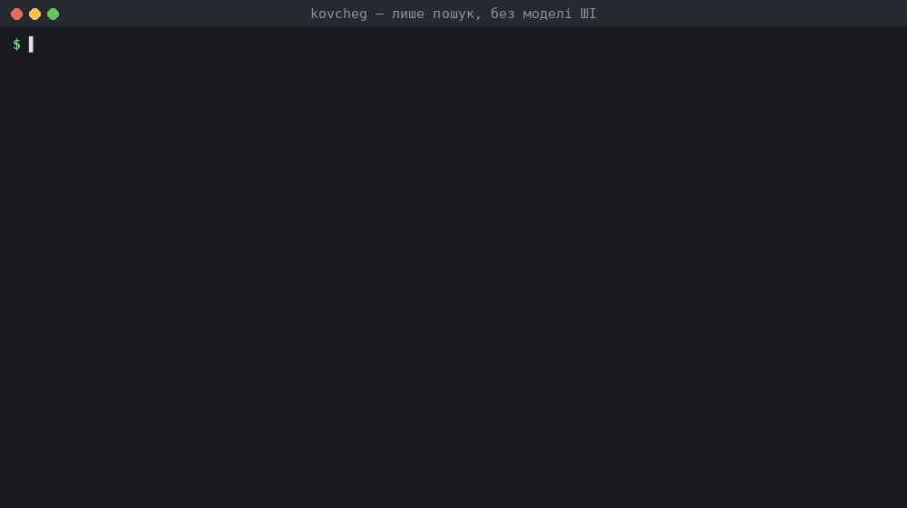
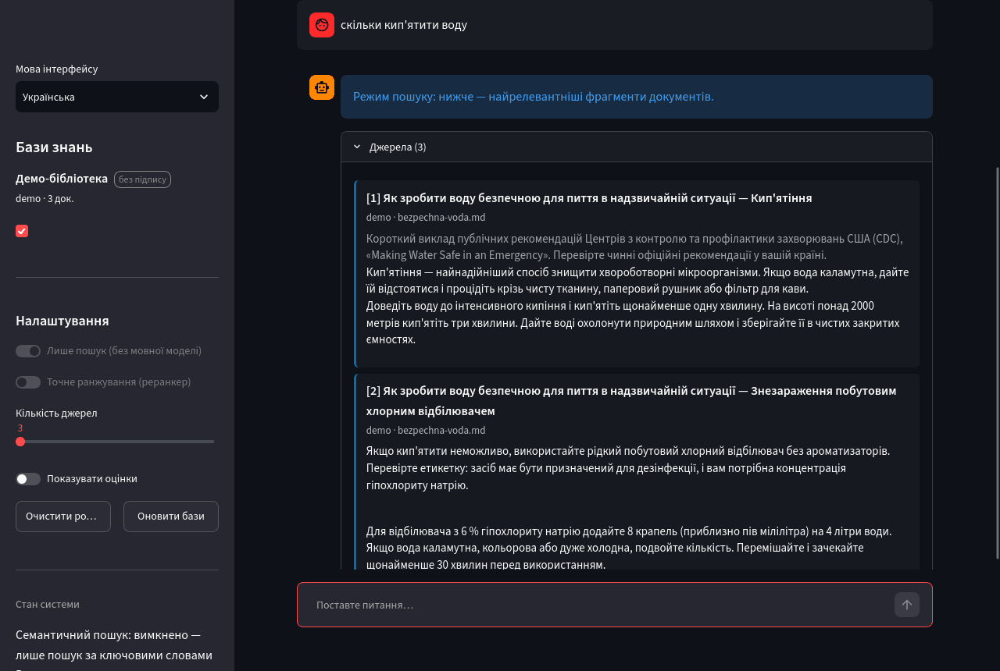

<div align="center">

# Ковчег (Kovcheg) — офлайн-відповіді з ваших власних документів

**Система запитань і відповідей на основі пошуку (RAG), що працює без інтернету на міні-ПК або з USB-накопичувача й створена для надзвичайних ситуацій.**

[English](README.md) · [Документація](docs/uk/README.md) · [Відповідальне використання](RESPONSIBLE_USE.uk.md) · [Безпека](docs/uk/SECURITY.md)

`MIT` · `v1.0.0` · `Python ≥ 3.11` · `100 % офлайн` · `пошук працює лише з numpy`

</div>

---

<p align="center"></p>

<p align="center"><em>Справжній вивід на <a href="examples/DEMO.md">демо-бібліотеці</a> (українська версія — <code>examples/demo-library-uk</code>), лише пошук за ключовими словами, без жодної моделі ШІ: уривок, що відповідає на питання, разом із джерелом, і чесна відмова, коли в бібліотеці немає нічого релевантного. Записано скриптом <code>scripts/make_cli_gif.py</code>.</em></p>

Коли зв'язку немає — після катастрофи, у полі, на кораблі, в укритті, у підвалі під час повітряної тривоги, — потрібні знання часто вже є на диску: посібники з першої допомоги, протоколи польової медицини, документація до обладнання, довідники з водопостачання та електроживлення, офлайн-Вікіпедія. **Ковчег** перетворює таку бібліотеку на співрозмовника, якому можна ставити запитання звичайною мовою. Він знаходить потрібні уривки й показує їх із точними посиланнями (документ, сторінка, розділ). Якщо доступна локальна мовна модель, Ковчег також пише коротку відповідь із посиланнями на ці уривки у вигляді `[1]`, `[2]`.

Усе працює локально. Нічого нікуди не надсилається. Жодних облікових записів, телеметрії чи хмари.

> [!IMPORTANT]
> Ковчег знаходить і стисло переказує те, що є у **ваших** документах. Він може щось пропустити, а мовна модель може їх неправильно прочитати. У ситуації, що загрожує життю, дійте за офіційними протоколами та, якщо можете, звертайтеся до екстрених служб. Завжди перевіряйте наведене джерело, перш ніж діяти. Див. [RESPONSIBLE_USE.uk.md](RESPONSIBLE_USE.uk.md).

## Зміст

- [Чому Ковчег](#чому-ковчег)
- [Як це працює](#як-це-працює)
- [Швидкий старт](#швидкий-старт)
- [Оберіть рівень обладнання](#оберіть-рівень-обладнання)
- [Створення бібліотеки](#створення-бібліотеки)
- [Як ставити запитання](#як-ставити-запитання)
- [Цілісність і підписані модулі](#цілісність-і-підписані-модулі)
- [Запуск з USB-накопичувача](#запуск-з-usb-накопичувача)
- [Обмеження](#обмеження)
- [Структура проєкту](#структура-проєкту)
- [Ліцензія](#ліцензія) · [Цитування](#цитування)

## Чому Ковчег

- **Працює на будь-якому обладнанні.** Маючи лише Python і numpy, Ковчег є швидкою системою повнотекстового пошуку (SQLite FTS5 / BM25) у вашій бібліотеці. Додайте модель ембедингів BGE-M3 — і отримаєте семантичний пошук різними мовами, крос-енкодер — для точнішого ранжування, а невелику мовну модель у форматі GGUF — для письмових відповідей. Кожен компонент необов'язковий і використовується лише тоді, коли він є.
- **Відповіді, які можна перевірити.** Кожна відповідь побудована лише на пронумерованих джерелах, показаних поруч із нею. Номери посилань завжди відповідають списку. Для кожного джерела вказано документ, сторінку й розділ. Якщо в бібліотеці немає нічого доречного, Ковчег так і каже, а не дає моделі вгадувати.
- **Дружній до малих комп'ютерів.** Вектори зберігаються у float16 і відображаються в пам'ять (memory-mapped), тож велика бібліотека не мусить уміщатися в оперативну пам'ять. Моделі завантажуються лише за потреби. Типові налаштування розраховані на міні-ПК із 8 ГБ оперативної пам'яті без GPU.
- **Гібридний пошук.** Щільні семантичні вектори, розріджені лексичні ваги BGE-M3 і BM25 об'єднуються зваженим методом Reciprocal Rank Fusion (RRF). Точні рядки на кшталт `J18.9`, `500 mg` чи номерів деталей знаходяться навіть тоді, коли семантична модель їх не розуміє.
- **Цілісність, яку можна перевірити.** Кожен модуль (база знань) має маніфест із хешами SHA-256 його файлів, за бажанням підписаний Ed25519. Ковчег показує, чи модуль цілий, не підписаний або змінений.
- **Інкрементне й надійне індексування.** PDF (з номерами сторінок), DOCX (із заголовками), TXT, Markdown, HTML, CSV, JSON і архіви ZIM (офлайн-Вікіпедія та інші). Повторне збирання обробляє лише змінені файли. Перерване збирання залишає попередній модуль неушкодженим.

## Як це працює

```
                        індексування (один раз для бібліотеки)
документи ─► читачі (сторінки PDF, заголовки DOCX/MD, HTML, ZIM) ─► фрагменти з урахуванням структури + сторінка й розділ
          ─► SQLite: текст + FTS5 (BM25)  ─►  [BGE-M3] щільні вектори float16 (memory-mapped) + розріджені ваги
          ─► manifest.json із SHA-256 кожного файлу  ─►  [необов'язково] підпис Ed25519

                        відповідь (на кожне запитання)
запитання ─► BM25        ┐
          ─► щільний     ├─► зважене злиття RRF ─► дедуплікація + ліміт на документ ─► [реранкінг топ-20 крос-енкодером]
          ─► розріджений ┘
          ─► перевірка доказів (нічого доречного → «у бібліотеці немає», мовна модель не викликається)
          ─► сусідні фрагменти додаються для контексту ─► [локальна мовна модель через llama.cpp] відповідь із посиланнями [n]
          ─► перевірка посилань ─► відповідь + пронумеровані джерела (документ, сторінка, розділ)
```

Компоненти у квадратних дужках необов'язкові. У [docs/uk/architecture.md](docs/uk/architecture.md) пояснено кожен етап і рішення, ухвалені під час проєктування.

## Швидкий старт

```bash
git clone https://github.com/sashapiscivca-svg/Kovcheg && cd Kovcheg
python3 -m venv .venv && . .venv/bin/activate          # Windows: .venv\Scripts\activate
pip install -e ".[docs,ui]"                              # лише пошук: читачі документів + вебінтерфейс, без ML-моделей

kovcheg init                                             # створює modules/, sources/, models/, keys/ і kovcheg.toml
kovcheg build demo --source examples/demo-library-uk --no-embed && kovcheg ask "скільки кип'ятити воду" -m demo   # спробувати
mkdir -p sources/first-aid && cp ~/Downloads/*.pdf sources/first-aid/
kovcheg build first-aid --no-embed                       # модуль лише з BM25, збирається за лічені секунди
kovcheg ask "how to stop severe bleeding" -m first-aid   # виводить знайдені уривки з номерами сторінок
kovcheg ui                                               # вебінтерфейс на http://127.0.0.1:8501
```

Щоб додати семантичний пошук і письмові відповіді, установіть додаткові пакети, покладіть моделі в `models/` (див. наступний розділ) і перезберіть модуль без `--no-embed`:

```bash
pip install -e ".[full]"
kovcheg doctor                                           # перевіряє Python, оперативну пам'ять, бібліотеки, моделі й модулі
kovcheg build first-aid
```

## Оберіть рівень обладнання

| Рівень | Обладнання | Компоненти | Орієнтовне використання RAM | Що ви отримуєте |
|---|---|---|---:|---|
| **S — пошук** | будь-який комп'ютер із 2 ГБ RAM, навіть Raspberry Pi | numpy (+ читачі документів) | < 0,5 ГБ | пошук за ключовими словами (BM25) з посиланнями на сторінки |
| **A — міні-ПК** | 8 ГБ RAM, 4-ядерний процесор (напр., Intel N100) | + BGE-M3, + Qwen2.5-1.5B-Instruct Q4_K_M | ≈ 4 ГБ | семантичний багатомовний пошук + короткі відповіді з посиланнями |
| **B — ноутбук** | 16 ГБ RAM | + BGE reranker v2-m3, + Phi-3.5-mini Q4_K_M або Qwen2.5-7B-Instruct Q4_K_M | 7–10 ГБ | найкраще ранжування та якісніші відповіді |

| Модель | Роль | Ліцензія | Розмір завантаження | Джерело |
|---|---|---|---:|---|
| BAAI/bge-m3 | щільні + розріджені ембединги, понад 100 мов | MIT | 2,3 ГБ | https://huggingface.co/BAAI/bge-m3 |
| BAAI/bge-reranker-v2-m3 | реранкер (крос-енкодер) | Apache-2.0 | 2,3 ГБ | https://huggingface.co/BAAI/bge-reranker-v2-m3 |
| Qwen2.5-1.5B-Instruct (Q4_K_M GGUF) | генерує відповіді, рівень A | Apache-2.0 | 1,1 ГБ | https://huggingface.co/Qwen/Qwen2.5-1.5B-Instruct-GGUF |
| Phi-3.5-mini-instruct (Q4_K_M GGUF) | генерує відповіді, рівень B | MIT | 2,4 ГБ | https://huggingface.co/bartowski/Phi-3.5-mini-instruct-GGUF |
| Qwen2.5-7B-Instruct (Q4_K_M GGUF) | генерує відповіді, рівень B | Apache-2.0 | 4,7 ГБ | https://huggingface.co/Qwen/Qwen2.5-7B-Instruct-GGUF |

Підійде будь-яка інструктивна (instruction-tuned) модель у форматі GGUF, бо Ковчег використовує шаблон чату, збережений у файлі. Перевірте ліцензію обраної моделі. Наприклад, Qwen2.5-3B-Instruct **не** ліцензовано для комерційного використання. Моделі не входять до цього репозиторію, і Ковчег ніколи нічого не завантажує сам. У [docs/uk/models.md](docs/uk/models.md) наведено команди для завантаження та приклади `kovcheg.toml` для кожного рівня.

## Створення бібліотеки

**Модуль** — це одна база знань, наприклад `first-aid`, `water-and-power` чи `wikipedia-uk`. Покладіть його документи в `sources/<module>/` і зберіть його:

```bash
kovcheg build first-aid --title "First aid" --description "Red Cross manual, field medicine protocols"
kovcheg build first-aid                 # надалі: обробляються лише нові або змінені файли
kovcheg build first-aid --rebuild       # з нуля
kovcheg modules                         # список модулів із розміром, енкодером і станом цілісності
kovcheg inspect first-aid               # документи, фрагменти й налаштування одного модуля
```

Підтримувані формати: PDF, DOCX, TXT, Markdown, HTML, CSV, JSON, вихідний код, ZIM (офлайн-Вікіпедія, WikiMed, iFixit та інші з бібліотеки Kiwix). Скановані PDF без текстового шару спершу потребують OCR; Ковчег позначає такі файли як порожні.

Індексування з BGE-M3 — найповільніший етап на процесорі міні-ПК: десятки тисяч сторінок обробляються годинами. Великі бібліотеки індексуйте один раз на потужнішому комп'ютері й копіюйте теку `modules/`; модулі переносяться між комп'ютерами та операційними системами.

## Як ставити запитання

```bash
kovcheg ask "дозування парацетамолу для дітей" -m first-aid
kovcheg ask "how to purify water without chemicals" -m water -m wikipedia --top-k 10
kovcheg search "J18.9" -m medicine                    # лише джерела, без мовної моделі
kovcheg ask "..." --json                               # машинозчитуваний вивід
```



Вебінтерфейс (`kovcheg ui`) робить те саме у вигляді чату, з перемикачем режиму «лише пошук» і позначками цілісності для кожного модуля. Типово він доступний лише на цьому комп'ютері. Щоб обслуговувати телефони чи ноутбуки в локальній мережі (наприклад, у Wi-Fi укриття), задайте `host = "0.0.0.0"` у `kovcheg.toml`.

## Цілісність і підписані модулі

```bash
kovcheg keygen                 # пара ключів Ed25519 у keys/ (файл приватного ключа з правами 0600)
kovcheg sign first-aid         # підписати маніфест модуля (якщо ключ існує, збирання підписуються автоматично)
kovcheg verify                 # повторно обчислити хеші всіх файлів кожного модуля й перевірити підписи
```

Модуль позначається як **valid** (дійсний: хеші збігаються, а підпис зроблено довіреним ключем), **unsigned** (без підпису: хеші збігаються, підпису немає), **untrusted** (недовірений: підписаний невідомим ключем) або **INVALID** (недійсний: файли змінено чи пошкоджено). Недійсні модулі в інтерфейсі типово вимкнено. Щоб довіряти модулям, які зібрав хтось інший, покладіть його відкритий ключ у `keys/trusted/`. Див. [SECURITY.md](docs/uk/SECURITY.md) і [docs/uk/integrity.md](docs/uk/integrity.md).

## Запуск з USB-накопичувача

Усе розгортання — це одна тека: код, середовище Python, `models/`, `modules/`, `keys/` і `kovcheg.toml`. Задайте `KOVCHEG_HOME` (або запускайте Ковчег із цієї теки), і все буде знайдено відносно неї. У [docs/uk/portable.md](docs/uk/portable.md) показано, як підготувати офлайн-набір на USB-накопичувачі для Linux і Windows з офлайн-сховищем пакетів (wheelhouse), щоб цільовому комп'ютеру не були потрібні ні інтернет, ні права адміністратора.

## Обмеження

- Якість пошуку залежить від документів. Скановані PDF без OCR, таблиці, сплющені в суцільний текст, і дуже довгі неструктуровані сторінки знижують якість.
- Малі мовні моделі (1,5–4 млрд параметрів) можуть неправильно прочитати уривки або переплутати числа. Ковчег тримає відповіді в межах джерел і показує їх, але не може гарантувати правильного прочитання. Прочитайте наведений уривок, перш ніж діяти щодо дози, інтервалу чи технічної межі.
- Пошук BM25 працює на рівні слів. Без BGE-M3 запитання мусить мати спільні слова з відповіддю, а міжмовний пошук не працює.
- Немає OCR, зображень і аудіо. Таблиці в PDF читаються як звичайний текст.

## Структура проєкту

```
src/kovcheg/      пакет: config, readers, chunking, store (формат модуля), builder, embedding,
                  retrieval, rerank, generation, engine, security, migrate, cli, ui/
tests/            набір тестів pytest; виконується на CPU за секунди з фіктивними моделями (без завантажень)
docs/en, docs/uk  документація англійською та українською
examples/         приклад kovcheg.toml для кожного рівня обладнання
```

## Ліцензія

MIT, див. [LICENSE](LICENSE). Сторонні моделі, бібліотеки й дані мають власні ліцензії, перелічені в [NOTICE.uk.md](NOTICE.uk.md). Необов'язковий читач ZIM використовує `libzim`, що має ліцензію GPL-3.0-or-later; він установлюється лише з додатковим пакетом `zim`.

## Цитування

```bibtex
@software{kovcheg_2026,
  title   = {Kovcheg: offline retrieval-augmented question answering for emergencies and small computers},
  author  = {{The Kovcheg authors}},
  year    = {2026},
  version = {1.0.0},
  license = {MIT},
  url     = {https://github.com/sashapiscivca-svg/Kovcheg}
}
```
